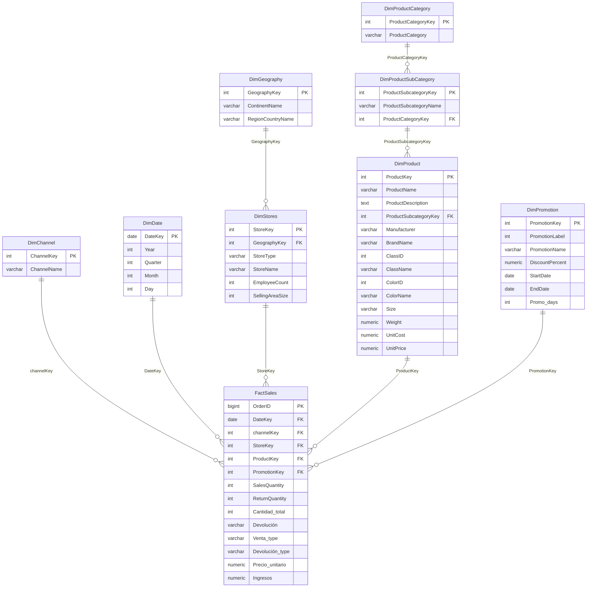

# Base de datos Contoso Sales

## Descripción

Esta carpeta contiene la implementación de la base de datos relacional del proyecto Contoso Sales, desarrollada en PostgreSQL.

La base de datos organiza la información de ventas mediante un modelo dimensional que permite relacionar las transacciones con información de fechas, productos, tiendas, geografía, canales de venta y promociones.

La implementación incluye:

- Diseño y creación del esquema relacional.
- Carga de dimensiones desde un archivo Excel.
- Generación de la dimensión de fechas.
- Carga de la tabla de hechos desde un archivo TXT.
- Restricciones de integridad referencial.
- Validaciones de integridad y consistencia de los datos.

## Estructura de la base de datos

La base de datos contiene nueve tablas: siete dimensiones provenientes del conjunto de datos original, una dimensión de fechas generada y una tabla de hechos.

### Diagrama entidad-relación



### Granularidad de FactSales

Cada registro de `FactSales` representa una observación individual de venta identificada por `OrderID`.

En el conjunto de datos analizado, `OrderID` es único para los 2,282,482 registros.

Cada registro está asociado con una fecha, un canal, una tienda, un producto y una promoción.

## Tablas y registros

| Tabla | Registros |
|---|---:|
| DimChannel | 4 |
| DimDate | 1,096 |
| DimGeography | 674 |
| DimStores | 310 |
| DimProductCategory | 8 |
| DimProductSubCategory | 44 |
| DimProduct | 1,690 |
| DimPromotion | 28 |
| FactSales | 2,282,482 |

## Relaciones principales

Las relaciones entre las tablas se implementan mediante claves primarias y foráneas.

- `FactSales` se relaciona con las cinco dimensiones descriptivas y con `DimDate`.
- `DimStores` se relaciona con `DimGeography`.
- `DimProduct` se relaciona con `DimProductSubCategory`.
- `DimProductSubCategory` se relaciona con `DimProductCategory`.

La jerarquía de productos y la información geográfica se mantienen normalizadas en tablas independientes.

## Requisitos

Para ejecutar los scripts se requiere:

- PostgreSQL.
- Python 3.
- Las siguientes bibliotecas de Python:

```bash
pip install pandas sqlalchemy psycopg2-binary openpyxl
```

## Archivos del proyecto

```text
database/
├── README.md
└── sql/
    ├── 01_create_schema.sql
    ├── 02_load_dimensions.py
    ├── 03_load_factsales.py
    └── 04_validate_database.sql
```

Los archivos de origen utilizados para la carga son:

- `Contoso Sales.xlsx`: contiene las tablas de dimensiones.
- `FactSales.txt`: contiene los registros de ventas.

Estos archivos deben estar ubicados en la raíz del proyecto, junto a las carpetas `database/` y `scripts/`.

Por su tamaño y origen, los archivos de datos no se incluyen en el repositorio.

## Instrucciones de instalación y uso

### 1. Crear la base de datos

Desde pgAdmin, crear una base de datos llamada:

```text
contoso_sales
```

### 2. Configurar la conexión

Los scripts de Python utilizan los siguientes parámetros de conexión:

| Parámetro | Valor |
|---|---|
| Host | localhost |
| Puerto | 5433 |
| Base de datos | contoso_sales |
| Usuario | postgres |

El puerto y el usuario pueden modificarse en `DB_CONFIG` dentro de los scripts de carga, según la configuración local de PostgreSQL.

La contraseña se solicita durante la ejecución y no se almacena en el código.

### 3. Crear el esquema

Ejecutar desde pgAdmin el archivo:

```text
database/sql/01_create_schema.sql
```

Este script crea las nueve tablas, sus restricciones y los registros correspondientes a `DimDate`.

### 4. Cargar las dimensiones

Desde la raíz del proyecto, ejecutar:

```bash
python database/sql/02_load_dimensions.py
```

El script lee las hojas del archivo Excel y carga las siete dimensiones originales.

### 5. Cargar la tabla de hechos

Ejecutar:

```bash
python database/sql/03_load_factsales.py
```

El proceso lee `FactSales.txt` por bloques y utiliza el comando `COPY` de PostgreSQL para realizar la inserción de manera eficiente.

La carga incluye el procesamiento de fechas y la normalización del formato numérico del archivo de origen.

El script utiliza una transacción para evitar que una carga fallida deje registros parcialmente insertados. También comprueba que la tabla no contenga registros previamente cargados.

### 6. Validar la base de datos

Ejecutar desde pgAdmin el archivo:

```text
database/sql/04_validate_database.sql
```

Este script realiza comprobaciones de solo lectura sobre la base de datos:

- Cantidad de registros por tabla.
- Unicidad de `OrderID`.
- Rango y cantidad de fechas.
- Integridad referencial entre las tablas.
- Estado de las restricciones de claves primarias y foráneas.
- Consistencia entre `Ingresos`, `Precio_unitario` y `Cantidad_total`.
- Valores negativos en las cantidades.
- Correspondencia entre `Devolución` y `ReturnQuantity`.

Los resultados permiten identificar las comprobaciones correctas (`OK`) y aquellas que requieren revisión (`REVISAR`).

## Validaciones realizadas

Durante la implementación se verificaron los siguientes resultados:

- 2,282,482 registros cargados en `FactSales`.
- 2,282,482 valores distintos de `OrderID`.
- Ninguna referencia inválida entre las tablas.
- Restricciones de claves primarias y foráneas activas y validadas.
- Consistencia entre los ingresos y el precio unitario multiplicado por la cantidad total.
- Ausencia de cantidades negativas.
- Correspondencia entre los indicadores de devolución y las cantidades devueltas.

Las comprobaciones realizadas sobre los datos originales y la base cargada no identificaron inconsistencias en las relaciones y fórmulas verificadas.

## Tecnologías utilizadas

- PostgreSQL
- Python
- Pandas
- SQLAlchemy
- Psycopg2
