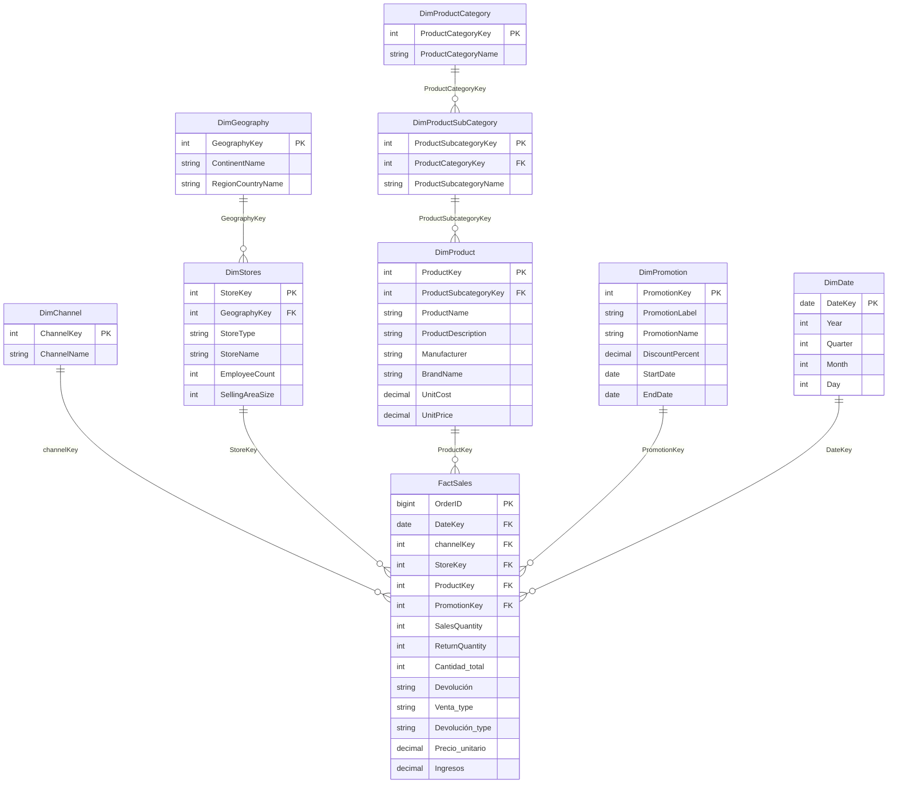

# Base de datos – Contoso Sales

## 1. Descripción general

Esta base de datos almacena y organiza la información del conjunto de datos **Contoso Sales**, con el objetivo de facilitar el análisis de las ventas, devoluciones, productos, tiendas, promociones y canales de venta.

Se utiliza un modelo dimensional con una tabla central de hechos (`FactSales`) y varias tablas de dimensiones. Algunas dimensiones se encuentran normalizadas para evitar redundancia y mantener la integridad referencial.

## 2. Diagrama de la estructura

El siguiente diagrama representa las tablas y sus relaciones principales:

## 3. Descripción de las tablas

### Tabla de hechos

| Tabla | Descripción |
|---|---|
| `FactSales` | Contiene los registros de ventas, cantidades vendidas, devoluciones e ingresos. Se relaciona con las dimensiones mediante claves foráneas. |

### Tablas de dimensiones

| Tabla | Descripción |
|---|---|
| `DimChannel` | Información de los canales de venta. |
| `DimGeography` | Información geográfica de las ubicaciones. |
| `DimStores` | Información de las tiendas y su ubicación geográfica. |
| `DimProduct` | Información de los productos, precios, costos y fabricantes. |
| `DimProductSubCategory` | Clasificación de los productos por subcategorías. |
| `DimProductCategory` | Clasificación general de las categorías de productos. |
| `DimPromotion` | Información de las promociones y sus descuentos. |
| `DimDate` | Dimensión temporal para facilitar el análisis de ventas por fechas. |

## 4. Relaciones e integridad referencial

Las relaciones principales de la base de datos son:

- `FactSales` referencia a `DimChannel`, `DimStores`, `DimProduct` y `DimPromotion`.
- `DimStores` referencia a `DimGeography`.
- `DimProduct` referencia a `DimProductSubCategory`.
- `DimProductSubCategory` referencia a `DimProductCategory`.
- `FactSales` referencia a `DimDate` para el análisis temporal.

Las relaciones se implementan mediante claves primarias y foráneas, con el propósito de mantener la integridad de los datos.

## 5. Fuente de datos

Los datos originales provienen del conjunto de datos Contoso Sales. La estructura se construye a partir de sus tablas de dimensiones y de la tabla de hechos `FactSales`.

Los registros originales se conservan durante el proceso de carga, incluyendo los valores nulos presentes en los datos de origen.